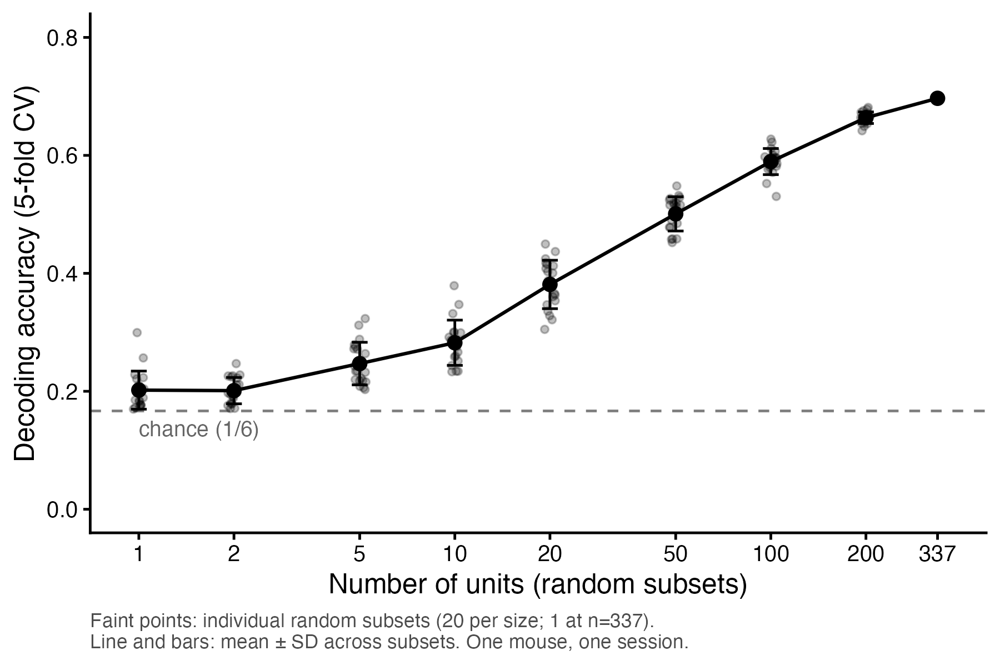
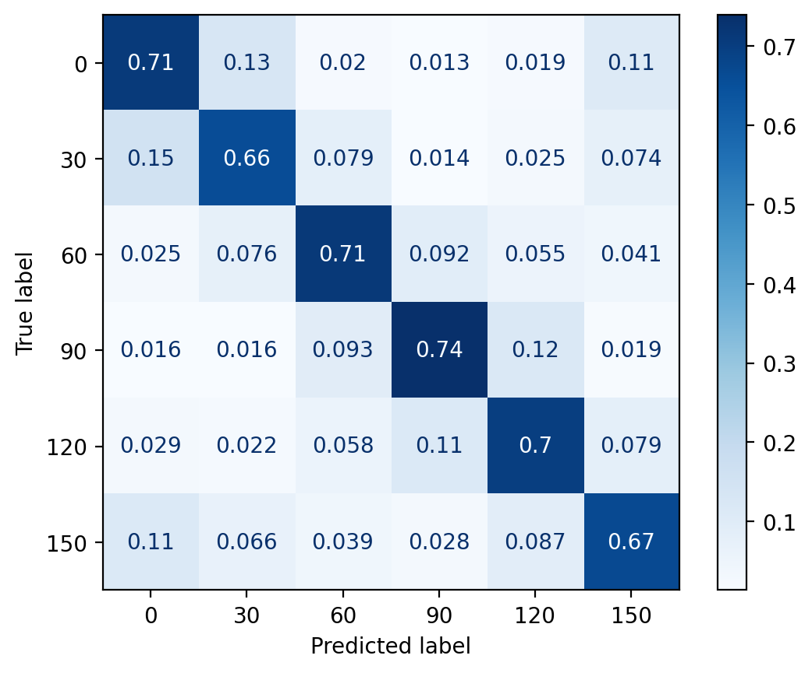
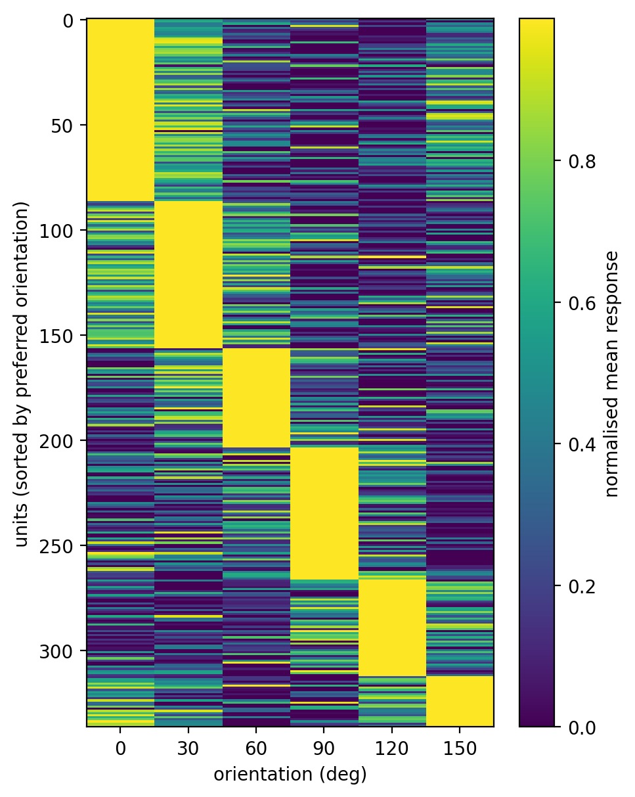

# Decoding stimulus orientation from mouse visual cortex (Neuropixels)

How much information about stimulus orientation is present in the spiking activity of mouse visual cortex, and how does it grow as more neurons are combined?

I used one Allen Institute Neuropixels recording and trained a linear decoder to predict which of six grating orientations was on screen from spike counts. I then repeated the decoding on random subsets of neurons of increasing size.

**Short answer:** in this recording, a population of 337 visual-cortex units decodes orientation at about 70% accuracy (chance = 16.7%), and accuracy rises steadily with population size. A single random unit is only slightly above chance (~20%).



## Data

- **Source:** Allen Brain Observatory, Visual Coding Neuropixels dataset (Allen Institute for Brain Science), accessed with the AllenSDK. See the Allen Institute's terms of use before redistributing any data.
- **Session:** 732592105 (`brain_observatory_1.1`). Wild-type (`wt/wt`) male mouse, 100 days old. Awake, head-fixed, passively viewing the stimulus.
- **Stimulus:** static gratings, 250 ms presentations, six orientations (0, 30, 60, 90, 120, 150°). Spatial frequency and phase also vary across trials and were not controlled for. Blank trials (193 of 6000) were excluded, leaving **5,807 trials** (956-981 per orientation).

## Methods

**Unit selection.** Units were restricted to visual cortical areas (VISp, VISl, VISal, VISpm, VISrl) and filtered on standard spike-sorting quality metrics: ISI violations < 0.5, amplitude cutoff < 0.1, presence ratio > 0.9, firing rate > 0.5 Hz. These are conventional starting values and were not tuned on decoding performance. **337 units** passed (VISp 104, VISal 77, VISpm 60, VISrl 58, VISl 38).

**Response matrix.** For each trial, spikes were counted per unit in the 0-250 ms window after stimulus onset (`presentationwise_spike_counts`), giving a trial x unit matrix of shape (5807, 337). The window was fixed before decoding.

**Decoder.** Multinomial logistic regression (L2 penalty) in a scikit-learn pipeline with standardisation, so scaling was fit on training folds only. The penalty strength `C` was chosen by **nested cross-validation** (inner 5-fold, grid 1e-4 to 1; `C = 0.01` was selected in every outer fold). Evaluation used stratified 5-fold cross-validation.

**Controls.**
- *Shuffled labels:* orientation labels permuted 20 times and the full pipeline re-run, to establish the empirical chance level.
- *Blocked cross-validation:* contiguous, unshuffled folds, to check for inflation from slow drifts across the session (arousal, electrode drift).

**Population size.** For n in {1, 2, 5, 10, 20, 50, 100, 200, 337}, units were drawn at random without replacement (20 random subsets per size, 1 at n = 337) and decoded with the same nested procedure.

## Results

| Analysis | Accuracy |
|---|---|
| Decoder, nested CV (random stratified folds) | 0.697 ± 0.011 |
| Decoder, blocked CV | 0.690 (folds 0.654-0.736) |
| Shuffled-label control | 0.166 ± 0.006 |
| Chance (1/6) | 0.167 |

**Accuracy by number of units** (mean across random subsets):

| Units | 1 | 2 | 5 | 10 | 20 | 50 | 100 | 200 | 337 |
|---|---|---|---|---|---|---|---|---|---|
| Accuracy | 0.202 | 0.201 | 0.247 | 0.282 | 0.381 | 0.501 | 0.589 | 0.664 | 0.697 |

Accuracy rises almost linearly with the log of population size between about 10 and 200 units, with some flattening at the largest sizes. It is not clearly saturated.

**Confusion matrix.** Per-orientation accuracy was 0.66-0.74, with no single orientation driving the result. Errors fell mainly on neighbouring orientations, including the wrap-around pair 0° and 150°; confusions between orientations 90° apart were rare (1-4%).



**Tuning.** Many units show clear single-peaked orientation tuning, and units preferring each orientation are present in similar numbers. Tuning is heterogeneous, with many broadly tuned units.



*Heatmap caption: units are sorted by preferred orientation and each row is normalised to its own range, so the diagonal band is partly produced by the sorting. It is a visual summary, not a measure of selectivity.*

## Limitations

- **One animal, one session.** Everything here describes a single recording. Spikes, trials and units from one mouse are not independent samples of mice, so no population-level claim is supported.
- **Error bars are across random subsets of the same 337 units.** They are not uncertainty about the animal-to-animal variation, and they shrink at large n because subsets overlap heavily (and n = 337 has only one subset).
- **Units are putative neurons** from spike sorting; some may be contaminated or incomplete.
- **Rate code, fixed window.** Spike timing within the 250 ms window is ignored.
- **Uncontrolled stimulus and state variables.** Spatial frequency, phase, running speed and arousal vary across trials and add variability. They were not modelled.
- **Linear decoder only.** Accuracy is a lower bound on the information present, not a measurement of it.
- **Pooled across five visual areas.** "Population size" mixes V1 and higher visual areas.
- **Information present is not information used.** A successful decoder shows the activity contains orientation information, not that the brain reads it out this way.
- **Blocked cross-validation reduces but does not remove temporal leakage** at fold boundaries.
- **Not extrapolated.** The curve says nothing about populations larger than the one recorded.

## Reproducing

1. Create the environment (see `requirements.txt`) and install the AllenSDK. Older AllenSDK releases need compatible `pynwb` / `hdmf` versions; the pinned versions in `requirements.txt` worked for this analysis.
2. Run the notebook(s) in `notebooks/`. The first call to `cache.get_session_data(732592105)` downloads several GB into `data/`.
3. Run `plot_decoding.R` to regenerate the final figure from `results/decoding_by_n.csv`.

```
neuropixels-decoding/
├── data/                # downloaded Allen data (git-ignored)
├── notebooks/           # unit selection, response matrix, decoding
├── results/             # decoding_by_n.csv, summary CSV, figures
├── plot_decoding.R      # final figure and summary statistics
├── requirements.txt
└── README.md
```

## Possible extensions

- Repeat the pipeline over several sessions and animals and plot one curve per session, which is the step that would support a general claim.
- Test the effect of correlated variability by shuffling trials within each orientation, per neuron, and comparing the decoding curves.
- Control for running speed, and compare areas (V1 against higher visual areas).

## Acknowledgements

Data from the Allen Institute for Brain Science, Allen Brain Observatory (Visual Coding Neuropixels). Please check the Allen Institute's current guidance for the preferred citation, for example Siegle et al. (2021), *Nature*.
